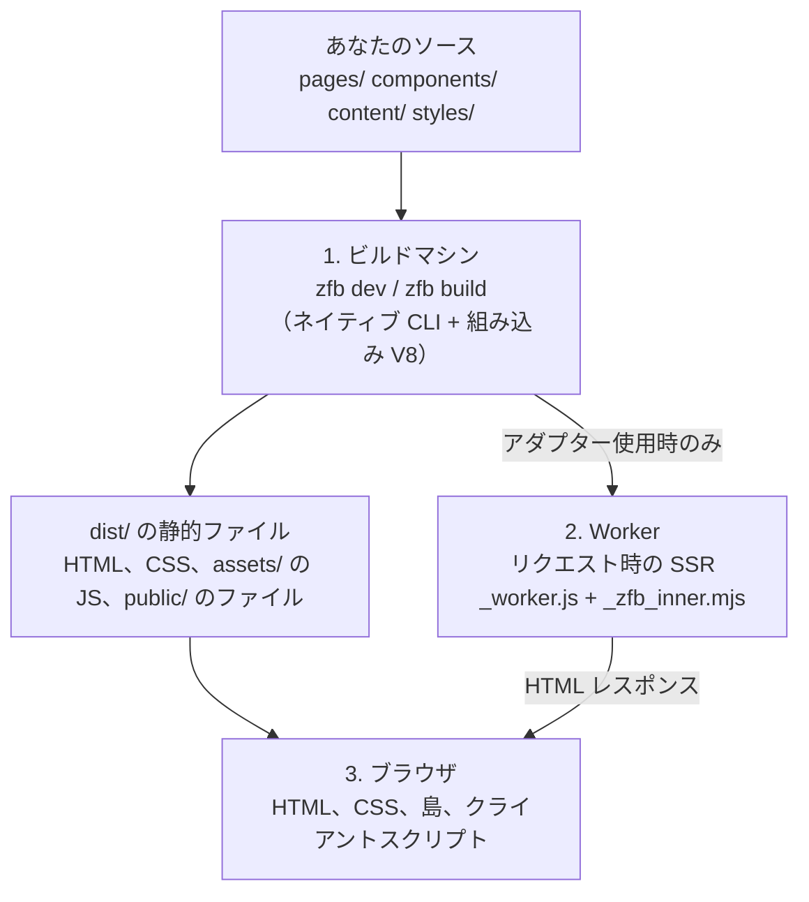

<Info title="このガイドの対象読者">

HTML、CSS、JavaScript、JSX と一般的なビルドツールは知っていて、zfb の Rust
ソースを読まずに全体像をつかみたい人向けです。このページは地図の役割を持ちます。
短いセクション、1 枚の図、そして詳しいルールを持つ各ページへのリンクで構成しています。
対象は現在公開されている `@takazudo/zfb` のアーキテクチャです。

</Info>

## zfb の構成要素

zfb は 1 つの製品ですが、いくつかの明確に分かれた部品からできています。import 文や
このドキュメントで出会う名前は次のとおりです。

| 部品 | import するもの・実行するもの | 担当すること |
| --- | --- | --- |
| **zfb**（CLI とビルドエンジン） | `zfb` コマンド。`@takazudo/zfb` 経由でインストール | プロジェクトを読み込み、バンドルし、ページをレンダリングして `dist/` に書き出します。*キャリアパッケージ* — ビルド済みバイナリを収めた、プラットフォームごとの小さな npm パッケージ（例: `@takazudo/zfb-linux-x64-gnu`）— で配布されるネイティブバイナリです。 |
| **ページとコンテンツのパイプライン** | `pages/` 配下のファイル、MDX/Markdown、コンテンツコレクション | ファイルシステムルーティング、動的ルートの `paths()`、`getCollection()` で読むコレクション。 |
| **zudo-react** | `@takazudo/zfb/zudo-react` とそのサブパス | zfb の JSX ランタイムとシグナルベースのコンポーネントモデル。React ではなく、独立した npm パッケージでもありません。 |
| **zudo-wind** | トップレベルの `wind` キー、`zfb css`、`@takazudo/zfb/css` | zfb のユーティリティ CSS コンパイラ。ソースからクラス候補を見つけ、設定で定義されたものについて CSS を生成します。 |
| **ランタイムパッケージ** | `@takazudo/zfb-runtime` | 両側で使うランタイムのコード。ビルドマシンと Worker で URL をページに対応付けるサーバー側ページルーター（`@takazudo/zfb-runtime/server`）と、ブラウザでのページ内ナビゲーション用の任意の `<ClientRouter />`。 |
| **デプロイアダプター** | `@takazudo/zfb-adapter-cloudflare` | リクエスト時にレンダリングするページを Cloudflare Worker として包み、`getCloudflareContext()` を提供します。 |

このドキュメントサイトが使っているフレームワーク **zudo-doc** は、エンジンの上に
作られたものです。これらの部品の利用者であって、部品の 1 つではありません。その境界は
[エンジンとフレームワーク](./engine-vs-framework.mdx) を、製品の概要は
[はじめに](../getting-started/introduction.mdx) を参照してください。

<a id="ビルド時とブラウザ-2-つの出力クラス"></a>
<a id="何がどこで動くのか"></a>

## 3 つの実行場所

zfb に関わるコードは、どれも次の 3 つの場所のどこかで動きます。混乱の多くは、
これらを取り違えることから生まれます。



| 場所 | 入力 | そこで起きること | 出力 |
| --- | --- | --- | --- |
| **1. ビルドマシン** — `zfb dev` や `zfb build` を実行しているあなたのコンピューターまたは CI | ソースファイルと `zfb.config.*` | `zfb` CLI がページをバンドルし、組み込みの V8 エンジンで実行してプリレンダリング対象のページを描画し、zudo-wind で CSS をコンパイルし、ブラウザ用のコードをバンドルします。 | `dist/` のファイル。アダプターがあれば Worker モジュールも出力します。`zfb dev` では同じ処理の結果をローカルの dev サーバーから配信します。 |
| **2. Worker** — リクエスト時の Cloudflare Worker（`prerender = false` のルートのみ） | HTTP リクエストと Worker のバインディング | Cloudflare のランタイム（workerd）が `_worker.js` を実行します。まず静的ファイルを配信し、該当しなければコンパイル済みのページ関数を呼び出します。 | HTTP レスポンス（通常は HTML）。 |
| **3. ブラウザ** — 訪問者の端末 | 配信された HTML、CSS、JavaScript | ブラウザが HTML を描画し、CSS を適用し、島をハイドレートし、クライアントスクリプトと（使っていれば）クライアントルーターを実行します。 | 訪問者が見て操作するもの。 |

Rust の CLI とその組み込み V8 エンジンはビルドマシンにとどまります。Worker に
アップロードされることも、ブラウザに配信されることもありません。

### 公開配信されるものとされないもの

`zfb build` のあと、`dist/` には 2 種類のファイルがあります。

- **公開される静的ファイル**。リクエストした誰にでもそのまま配信されます。
  プリレンダリングされた `.html` ページ、`assets/` 配下の CSS（例:
  `assets/styles-<hash>.css`）、`assets/` 配下のブラウザ用 JavaScript、そして
  `public/` のファイルです。
- **Worker モジュール**。Cloudflare アダプターを設定したときだけ書き出されます。
  `_worker.js`、`_zfb_inner.mjs`、およびそれらがインポートするコンパイル済みの
  `.wasm` ファイルです。アダプターはこれらを `dist/.assetsignore` に列挙するので
  アセットのアップロードからは除外され、`wrangler deploy` が Worker のコードとして
  デプロイします。

ブラウザ用 JavaScript は互いに独立した 2 つの仕組みから生まれます。プロジェクトは
どちらか、両方、あるいはどちらも使わないことができます。

- **島** — `"use client"` モジュールからエクスポートされたコンポーネントを
  ターゲットとする `<Island>` 境界の中でレンダリングされるコンポーネント。すべてが
  1 つのバンドル `assets/islands-<hash>.js` を共有します。島を含むビルドでは、
  zfb が生成したページにそのバンドルを読む `<script type="module">` タグを 1 つ追加し、
  バンドルが `mountIslands()` を呼んで各 `[data-zfb-island]` 要素をハイドレートします。
  [Islands](./islands.mdx) を参照してください。
- **クライアントスクリプト** — `pages/`、`components/`、`src/` 配下にある
  `<name>.client.ts`（または `.tsx`、`.js`、`.jsx`）ファイル。それぞれが個別に
  バンドルされ、本番では `/assets/client/<name>-<hash>.js` から配信されます。ページは
  `clientScript("name")` でそれを参照します。クライアントスクリプトは普通の ES
  モジュールで、コンポーネントをハイドレートすることも、島のプロトコルに
  参加することもありません。[クライアントスクリプト](../guides/client-scripts.mdx) を参照してください。

訪問者のブラウザに届くのはこれらのブラウザ用バンドルだけです。zfb がビルドマシンで
実行するページレンダリング用のバンドルが届くことはありません。

## モードではなく独立した選択

zfb には「静的モード」「SSR モード」「SPA モード」のどれか 1 つを選ぶ、という
仕組みはありません。自由に組み合わせられる別々の選択があるだけです。

| 選択 | 決めること | デフォルト | 有効にする方法 |
| --- | --- | --- | --- |
| **SSG か SSR か** | ページの HTML を *いつ* 生成するか（ビルド時に 1 回か、リクエストごとか） | ビルド時（SSG） | ページで `export const prerender = false`、加えて Cloudflare アダプター |
| **島とクライアントスクリプト** | ページがブラウザでの振る舞いを持つかどうか | なし | `<Island>` 境界、または `.client.*` ファイル |
| **ClientRouter** | リンクのクリックで新しいドキュメントを読み込む代わりに、その場で内容を差し替えるかどうか | 通常のページ遷移 | レイアウトに `<ClientRouter />` を置く |

プリレンダリングされたページに島を置くことも、リクエスト時のページを純粋な
HTML にすることも、島の有無にかかわらずクライアントルーターを使うこともできます。
それぞれの選択には専用の詳細ページがあります。
[SSR と Cloudflare バインディング](../guides/ssr-and-cloudflare-bindings.mdx)、
[Islands](./islands.mdx)、
[クライアントサイドルーティングと View Transitions](./client-side-routing.mdx) です。

この 3 つの *実行場所* は、3 つの *デプロイ形態* — 静的サイト、SSR ルート用の Worker を
加えた静的サイト、別のプログラムの内側で動くローカルコンテンツサーバー — とは別の話です。
デプロイ形態の選び方は [zfb を動かす 3 つの方法](./three-ways-to-run-zfb.mdx) を読んでください。

## 1 つのページを追いかける

以下の例は
[`zfb-example-kv-guestbook`](https://github.com/Takazudo/zfb-example-kv-guestbook)
と [`zfb-example-json-api`](https://github.com/Takazudo/zfb-example-json-api)
リポジトリをもとに、このガイドで扱う部分だけに絞ったものです。

### ステップ 1 静的なページ

`pages/` 配下のファイルはルートになります。`pages/index.tsx` は `/` です。

```tsx
// pages/index.tsx
// レイアウト（ここでは省略）は children の周りに <html>、<head>、<body> を描画し、
// `page-title` と `muted` を定義するサイト全体の CSS を import します。
import DefaultLayout from "../layouts/default";

export default function HomePage() {
  return (
    <DefaultLayout>
      <h1 class="page-title">Guestbook</h1>
      <p class="muted">Sign the guestbook below.</p>
    </DefaultLayout>
  );
}
```

`zfb build` の間に、ビルドマシンがこの関数を 1 回実行し、結果を `dist/index.html` に
書き出します。そのあと zfb がこのファイルにスタイルシートの `<link>`（ビルドに
島があれば島の `<script>` も）を追加します。リクエスト時には静的ホストが
このファイルを配信するだけで、ページのコードは実行されません。

JSX にも注目してください。zudo-react は HTML の属性名を使うので、`className` ではなく
`class` です。[コンポーネントと JSX](../zudo-react/components-and-jsx.mdx) を参照してください。

### ステップ 2 同じページをリクエストごとにレンダリングする

今度は、ビルド後に変わるデータ — ここでは Cloudflare KV ネームスペースに保存された値 —
をページに表示したいとします。エクスポートを 1 つ足すだけで、リクエスト時の
レンダリングに移ります。

```tsx
// pages/index.tsx
import { getCloudflareContext } from "@takazudo/zfb-adapter-cloudflare";
import DefaultLayout from "../layouts/default";

export const prerender = false;

interface Env {
  // `KVNamespace` は `@cloudflare/workers-types` の型です。
  GUESTBOOK: KVNamespace;
}

export default async function HomePage() {
  const { env } = getCloudflareContext<Env>();
  const greeting = await env.GUESTBOOK.get("greeting");

  return (
    <DefaultLayout>
      <h1 class="page-title">Guestbook</h1>
      <p class="muted">{greeting ?? "No greeting yet."}</p>
    </DefaultLayout>
  );
}
```

```ts
// zfb.config.ts — prerender = false のルートにはアダプターが必須
import { defineConfig } from "zfb/config";

export default defineConfig({
  adapter: "@takazudo/zfb-adapter-cloudflare",
});
```

変わる点は次のとおりです。

- `zfb build` は `dist/index.html` を書き出さなくなります。代わりにこのルートと、
  そこから import されるものすべてを `_zfb_inner.mjs` にバンドルし、アダプターが
  その周りに `_worker.js` というエントリを加えます。
- `/` へのリクエストが Worker に届くたびに、Worker はコンパイル済みの `HomePage`
  関数を呼び出します。関数はレイアウトや import したヘルパーを実行し、KV の読み取りを
  await し、返された JSX を HTML にレンダリングします。ビルド時にページがテンプレート
  文字列へ変換されているわけではありません。
- ページが受け取るのは引き続き **ページ props** であり、`Request` ではありません。
  リクエスト、`env`、`ctx` は `getCloudflareContext()` から取得します。これは Worker の
  リクエストの中でだけ動き、ビルド時のレンダリング中や `zfb dev` では例外を投げます。
  guestbook の例ではこの呼び出しを `try`/`catch` で包み、リクエストコンテキストが
  ないときは `503` を返しています。
  [デフォルトエクスポートが受け取るのは props であり Request ではない](../guides/ssr-and-cloudflare-bindings.mdx#デフォルトエクスポートが受け取るのは-props-であり-request-ではない)
  を参照してください。
- ステップ 1 の `<link>`/`<script>` の自動追加は、生成された HTML ファイルに対する
  ビルド時の後処理です。そのためリクエスト時のレスポンスには適用されません。
  その場合にレイアウトからスタイルシートを参照する方法は
  [サンプル: Webshop](../recipes/webshop.mdx) にあります。

### ステップ 3 インタラクティブな島を加える

インタラクティブな UI は別の選択です。コンポーネントは、`"use client"` モジュールから
エクスポートされ、`<Island>` 境界のただ 1 つの子として使われたときに島の
ターゲットになります。

```tsx
// components/counter.tsx
"use client";

import { signal } from "@takazudo/zfb/zudo-react";

export default function Counter() {
  const count = signal(0);
  return (
    <button on:click={() => { count.value += 1; }}>
      Count: {count}
    </button>
  );
}
```

```tsx
// pages/index.tsx — ステップ 1 の静的なページ
import { Island } from "@takazudo/zfb";
import Counter from "../components/counter";
import DefaultLayout from "../layouts/default";

export default function HomePage() {
  return (
    <DefaultLayout>
      <h1 class="page-title">Guestbook</h1>
      <Island>
        <Counter />
      </Island>
    </DefaultLayout>
  );
}
```

`Counter` は 2 つの場所で 2 回実行されます。ビルドマシンでは、ボタンの初期 HTML を
ページに描画します。ブラウザでは、島のバンドルがもう一度実行し、既存のボタンに
クリックハンドラを取り付けます。マークアップを置き換えるわけではありません。シグナルは
セットアップ時に 1 回だけ作られ、値が変わるとテキストが更新されます。コンポーネント関数が
再度呼ばれることはありません。

json-api の例は意図的にこの形を取っています。島はプリレンダリングされたページに
置き、ライブデータが必要なときは `fetch` で `prerender = false` の API ルートを
呼び出します。島、ハイドレーションのタイミング、境界の完全なルールは
[Islands](./islands.mdx) にあります。

## ルーティングとハイドレーション

次の 3 つの仕組みは混同しやすいものです。

| 仕組み | 動く場所 | すること |
| --- | --- | --- |
| **サーバー側ページルーター**（`@takazudo/zfb-runtime/server` の `createPageRouter`） | ビルドマシンと Worker | URL をページモジュールに対応付け、そのデフォルトエクスポートをページ props 付きで呼び出します。自動で生成されるので、自分で呼ぶことはありません。 |
| **ClientRouter**（`@takazudo/zfb-runtime` の `<ClientRouter />`） | ブラウザ（置いた場合のみ） | 同一オリジンのリンクのクリックを横取りし、次のページの HTML を取得して内容を差し替え、履歴とスクロールを管理します。 |
| **ハイドレーション**（zudo-react） | ブラウザ | すでにページ上にあるサーバー描画済みの DOM に、島の振る舞いを取り付けます。 |

これらは重なり合うのではなく、連携します。サーバー側ルーターは、事前でもリクエストごとでも、
すべての HTML ドキュメントを生成します。ClientRouter が変えるのは、ブラウザが次の
ドキュメントを *どう読み込むか* だけです。差し替えのあと、新しい内容に含まれる
島は受け取ったマークアップからマウントされます。ハイドレーションは
ClientRouter があってもなくても動きます。ClientRouter がなければ、すべての遷移は
通常のページ読み込みになり、島のバンドルが新しいページをハイドレートします。
詳しくは [ルーティング](./routing.mdx)、[クライアントサイドルーティングと View Transitions](./client-side-routing.mdx)、
[ハイドレーション](../zudo-react/hydration.mdx) を参照してください。

## CSS が生成される仕組み

zudo-wind は、ソースの中で見つけたクラス名からユーティリティ CSS を生成します。
ファイルを読むだけで、アプリケーションを実行はしません。そのため、スキャン対象の
ファイルのどこかに **完全な形で** 書かれているクラスしか見つけられません。

```tsx
function StatusBadge(props: { active: boolean }) {
  // 見つかる: 2 つの完全な候補がどちらもソースに現れている。
  const tone = props.active ? "bg-accent" : "bg-muted";
  return <span class={tone}>Status</span>;
}

function BrokenBadge(props: { color: string }) {
  // 見つからない: スキャナーに見えるのは断片 "bg-" だけで、これが展開されることはない。
  // `color` が実行時に何になっても、CSS は生成されない。
  return <span class={`bg-${props.color}`}>Status</span>;
}
```

組み立てたクラスを直すには、取りうる値をすべて完全な形で書き出します。`StatusBadge`
のような条件分岐か、`{ accent: "bg-accent", muted: "bg-muted" }[props.color]` のような
マップを使います。`wind.safelist` を使うのは、値がどのスキャン対象ファイルにも本当に
現れない場合だけです。
[断片を組み立てず完全な候補を書く](../zudo-wind/sources-and-candidates.mdx#断片を組み立てず完全な候補を書く)
を参照してください。

候補を見つけるのは最初の一歩にすぎません。候補が CSS になるのは、設定で定義された
ユーティリティとトークンに解決できたときだけです。zudo-wind は Tailwind ではありません。
Tailwind の設定は読まず、デフォルトのカラーパレットやスペーシングスケールも提供しません。
トークンはすべて `wind` の設定から来ます。上の 2 つのクラスは、両方の色を定義する最小限の
設定で動きます。

```ts
// zfb.config.ts
import { defineConfig } from "zfb/config";

export default defineConfig({
  wind: {
    spec: 1, // zudo-wind の言語バージョン。取りうる値は 1 だけ（デフォルトも 1）
    reset: "minimal-v1", // 小さな組み込みの CSS リセット。デフォルトは "none"
    tokens: {
      colors: { accent: "var(--app-accent)", muted: "var(--app-muted)" },
    },
    // どのスキャン対象ファイルにも現れない完全な候補（たとえば API からしか
    // 届かないクラス名）を、オーナー ID をキーにして列挙する。
    safelist: { app: ["text-accent"] },
  },
});
```

```css
/* トークンが参照するカスタムプロパティは、あなたが書く CSS で定義します。 */
:root {
  --app-accent: #2563eb;
  --app-muted: #5f6f65;
}
```

似て見える 3 つの入力は、それぞれ別の役割を持ちます。

- **`wind.safelist`** は、ソースの探索では見つからない完全な候補を追加します。たとえば
  API からしか届かないクラスです。各オーナー ID に完全な候補のリストを対応付けます。
  パターンやワイルドカードはありません。
- **パッケージのマニフェスト**（`wind.manifests`）は、パッケージが自分のコンポーネントで
  使う候補を公開するためのものです。これがあれば、あなたのビルドがそのパッケージの
  ソースをスキャンする必要はありません。
- **`authoredClasses`** は、あなたが自分で CSS に書くルールのために、正確なクラス名を
  予約します。自分のクラス名がユーティリティの綴りと重なるときに必要になります。たとえば
  スタイルシートで `.bg-hero`（手書きの背景画像）を定義していて、zudo-wind にそれを
  ユーティリティとして扱わせたくない場合です。その名前についてはユーティリティの生成を
  *抑止* するもので、CSS を生成することはありません。

もう 1 つの境界があります。zudo-wind はソースをスキャンするときに `className` 属性も
認識します。外部のパッケージや HTML がその綴りを使うからです。しかし、それで
`className` が zudo-react の JSX として有効になるわけではありません。完全なルールは
[ソースと候補](../zudo-wind/sources-and-candidates.mdx)、
[設定](../zudo-wind/configuration.mdx)、
[トークン](../zudo-wind/tokens.mdx) を読んでください。`wind` のすべてのフィールドは
[設定 — フィールド](../zudo-wind/configuration.mdx#フィールド) に一覧があります。

## zfb のサイトを作らずに部品を使う

サイト全体を zfb で作らなくても、zfb の一部だけを取り入れられます。

**zudo-react だけを使う。** zudo-react は `@takazudo/zfb` の中に含まれていて、別の
パッケージはありません。`@takazudo/zfb/zudo-react` とその公開サブパスから import します。
`/jsx-runtime` と `/jsx-dev-runtime`（JSX 変換用）、`/server`（サーバーレンダリング）、
`/client`（`hydrate`、`mount`、`parseProps`）、`/testing` です。zfb のビルドの外では、
JSX の変換とマウント／ライフサイクルの境界はあなたのホストが受け持ちます。zfb の
島の識別プロトコルを手で作り直すのではなく、既存のレシピに従ってください。
[自分で所有するホストから mount する](../zudo-react/hydration.mdx#自分で所有するホストから-mount-する)
と
[zfb ビルドの外で Island をレンダリングする](../zudo-react/server-rendering.mdx#zfb-ビルドの外で-island-をレンダリングする)
です。コンポーネントモデルは [zudo-react の概要](../zudo-react/overview.mdx) で説明しています。

**CSS だけを使う。** 入力は普通の CSS ファイルです。あなたが書いた CSS と `@import`
からなり、Tailwind のディレクティブは含みません。生成されるユーティリティは zudo-wind が
加えます。コマンドラインからは `zfb css` でコンパイルします。

```sh
zfb css --input styles/main.css --output dist/main.css
```

すべてのフラグは [`zfb css`](../api/cli.mdx#zfb-css) を参照してください。Node.js の
コードからは `@takazudo/zfb/css` の `compileCss` を使います。

```ts
import { compileCss } from "@takazudo/zfb/css";

const { css, diagnostics, warnings } = await compileCss({
  input: "styles/preview.css",
  projectRoot: "./preview",
  config: { wind: { reset: "none" } },
  sources: ["components/**/*.tsx"],
  noAutoSource: true,
});
```

`compileCss` は非同期で、Node.js 専用です。`@takazudo/zfb/css` を含む `@takazudo/zfb`
の npm パッケージは Node.js 24 以上を対象としています。スタンドアロンの `zfb` バイナリには
Node はまったく不要です。オプショナル依存関係を有効にして `@takazudo/zfb` をインストールすると、
プラットフォームに合ったキャリアパッケージが入り、`compileCss` はそのネイティブコンパイラを
プロセス内で実行します（zudo-react 自体は普通の TypeScript/JavaScript で、ネイティブの
キャリアは必要ありません）。`input` は
CSS ファイルへのパスで、CSS の文字列ではありません。`config` はあなたがすでに評価した
設定で、`compileCss` が `zfb.config.ts` を読み込むことはありません。ブラウザや Worker
向けのエントリポイントでもありません。[`compileCss`](../api/compile-css.mdx) を
参照してください。

<a id="hono-cloudflare-workers-への移植性という賭け"></a>

## どのホストでも同じハンドラの形

生成されるページレンダリング用のバンドルは、Cloudflare Workers のモジュールの形をしています。

```ts
export default {
  fetch(request, env, ctx) { /* ... */ }
};
```

この `fetch` がサーバー側ページルーターです。ビルドマシンでは、zfb の組み込み V8
エンジンがプリレンダリング対象の URL ごとに合成リクエストを 1 つ送り、HTML レスポンスを
それぞれファイルに書き出します。本番では workerd が本物のリクエストを送ります。どちらの
ホストも同じ `fetch` のコントラクトで話すので、ページのコードはどちらに駆動されているかを
知る必要がありません。

共通なのは形であって、バイト列ではありません。アダプターを設定すると、zfb は
`prerender = false` のルートとそれらが import するものだけに絞った **2 回目のバンドル**
を実行し、その小さいバンドルだけを `_zfb_inner.mjs` としてデプロイします。Worker 向けの
出力とリクエストのディスパッチは [Worker 上の SSR（アダプターモード）](./ssr-on-a-worker.mdx) で扱います。

<a id="レイヤリングのまとめ"></a>

## 変換と実行は別のもの

「zfb が TSX を動かす」という言い方には、4 つの別々の責務がまとめて含まれています。

| 責務 | 答える問い | zfb では |
| --- | --- | --- |
| **変換** | TSX、JSX、MDX はどうやって JavaScript モジュールになるのか | `zfb` CLI に内蔵されたバンドラーが、zudo-react の自動 JSX ランタイムを使って行います。 |
| **JavaScript エンジン** | その JavaScript を何が実行するのか | V8 です。ビルドマシンでは CLI に組み込まれたもの、Worker では workerd の中のもの、ブラウザではブラウザ自身のエンジンです。 |
| **ホスト API** | どのグローバルやモジュール（`fetch`、`Request`、DOM、`node:*`）が存在するのか | ホストごとに決まります。組み込みホストはページに必要な Web のリクエスト／レスポンス API を提供し、`node:fs` のようなモジュールは例外を投げます。Worker は Cloudflare の API を、ブラウザは DOM を提供します。 |
| **UI のレンダリング** | コンポーネントはどうやって HTML や動く DOM になるのか | zudo-react です。サーバーでは `renderToString`、ブラウザではハイドレーションまたはマウントです。 |

つまり、zfb が自前で持つ V8 ホストは別の JavaScript エンジンではなく、V8 の周りに
zfb が用意した層です。JavaScript の言語機能がすべて使えることは、Node.js の API が
使えることを意味しません。どちらも、React や Preact のコンポーネントが動くことを
意味しません。zudo-react は独自のコンポーネントモデルです。バックエンドの詳細と
その経緯は [JS ランタイム](./js-runtime.mdx) にあります。

## 次に読むもの

| やりたいこと | 読むページ |
| --- | --- |
| 最初のサイトを作る | [最初のサイト](../getting-started/your-first-site.mdx) |
| CSS の生成を理解する | [zudo-wind](../zudo-wind/index.mdx)、[ソースと候補](../zudo-wind/sources-and-candidates.mdx) |
| インタラクティブな UI を加える | [Islands](./islands.mdx)、[クライアントスクリプト](../guides/client-scripts.mdx) |
| コンポーネントを単体で使う | [zudo-react の概要](../zudo-react/overview.mdx) |
| リクエストごとにページをレンダリングする | [SSR と Cloudflare バインディング](../guides/ssr-and-cloudflare-bindings.mdx)、[Worker 上の SSR（アダプターモード）](./ssr-on-a-worker.mdx) |
| デプロイ形態を選ぶ | [zfb を動かす 3 つの方法](./three-ways-to-run-zfb.mdx) |
| 内部を調べる | [ビルドパイプライン](./build-pipeline.mdx)、[ビルドエンジン](./build-engine.mdx)、[JS ランタイム](./js-runtime.mdx) |
