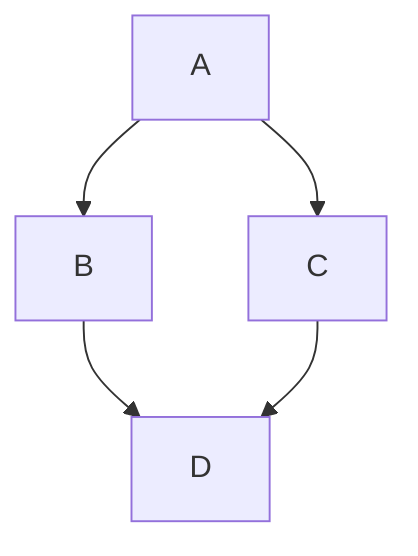

`mermaid` 機能は、[Mermaid](https://mermaid.js.org/) のフェンス付きコードブロックをビルド時にマークします。zfb はコードブロックを `<div class="mermaid">` に置き換えます。図の描画は、Mermaid runtime がその要素を処理するときにクライアントサイドで行われます。

## 有効化

```ts
// zfb.config.ts
import { defineConfig } from "zfb/config";

export default defineConfig({
  markdown: {
    features: {
      mermaid: true,
    },
  },
});
```

## 使い方

`mermaid` 言語タグを付けたフェンス付きコードブロックを書きます:

````md

````

ビルド時に、プラグインは `<pre><code class="language-mermaid">` ブロックを次のように置き換えます:

```html
<div class="mermaid" data-mermaid="">graph TD; ...</div>
```

`data-mermaid` 属性と `mermaid` クラスは、クライアント側の Mermaid レンダラーに処理対象を伝えます。ソースは HAST のテキストノードとして保持され、HTML へのシリアライズ時に `&`、`<`、`>` を `&amp;`、`&lt;`、`&gt;` にエスケープします。ブラウザーが HTML を解析すると元の DOM テキストに戻るため、Mermaid レンダラーは変更されていない DSL を受け取ります。生の未エスケープ HTML を挿入する仕組みではありません。

## ビジターの順序

`MermaidPlugin` は hast フェーズで `SyntectPlugin` の**前に**実行されます。これにより、syntect が mermaid ブロックをシンタックスハイライトしようとしないことが保証されます。`<pre>` が `<div class="mermaid">` に置き換えられると、syntect の `<pre><code>` セレクターはもう一致しなくなるためです。
