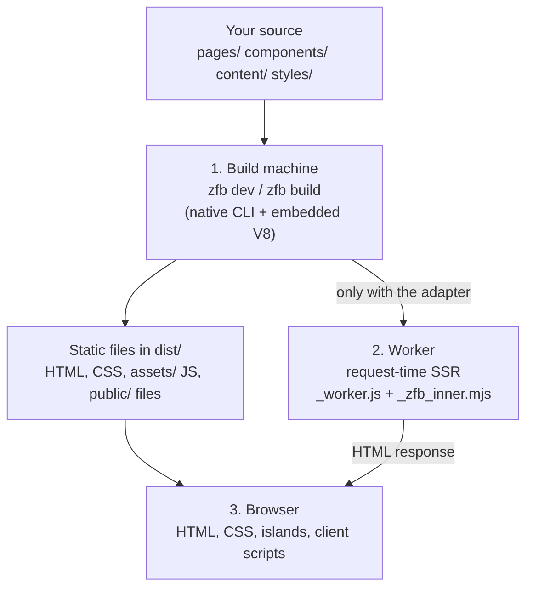

<Info title="Who this guide is for">

You know HTML, CSS, JavaScript, JSX and ordinary build tools, and you want a
working mental model of zfb without reading its Rust source. This page is the
map: short sections, one diagram, and links to the detail pages that own the
full rules. It describes the published `@takazudo/zfb` 5.x line.

</Info>

## The parts of zfb

zfb is one product with a few clearly separated parts. Names you will meet in
imports and in these docs:

| Part | What you import or run | What it is responsible for |
| --- | --- | --- |
| **zfb** (CLI and build engine) | the `zfb` command, installed through `@takazudo/zfb` | Reads your project, bundles it, renders pages, writes `dist/`. A native binary delivered by platform-specific carrier packages. |
| **Pages and content pipeline** | files under `pages/`, MDX/Markdown, content collections | File-system routes, `paths()` for dynamic routes, collections read with `getCollection()`. |
| **zudo-react** | `@takazudo/zfb/zudo-react` and its subpaths | zfb's JSX runtime and signal-based component model. It is not React and not a separate npm package. |
| **zudo-wind** | the top-level `wind` key; `zfb css`; `@takazudo/zfb/css` | zfb's utility-CSS compiler. It finds class candidates in your source and generates CSS for the ones your configuration defines. |
| **Browser runtime** | `@takazudo/zfb-runtime` | The optional `<ClientRouter />` for in-page navigation, and the server page router (`@takazudo/zfb-runtime/server`) that maps URLs to pages. |
| **Deployment adapter** | `@takazudo/zfb-adapter-cloudflare` | Wraps request-time pages as a Cloudflare Worker and provides `getCloudflareContext()`. |

**zudo-doc**, the framework this documentation site runs on, is built on top
of the engine; it is a consumer of these parts, not one of them. See
[Engine vs Framework](./engine-vs-framework.mdx) for that boundary and
[Introduction](../getting-started/introduction.mdx) for the product overview.

<a id="build-time-vs-browser-the-two-classes-of-output"></a>
<a id="what-runs-where"></a>

## Three execution locations

Every piece of zfb-related code runs in one of three places. Most confusion
comes from mixing them up.



| Location | Inputs | What happens there | Outputs |
| --- | --- | --- | --- |
| **1. Build machine** — your computer or CI, during `zfb dev` and `zfb build` | Your source files and `zfb.config.*` | The `zfb` CLI bundles your pages, runs them in its embedded V8 engine to render prerendered pages, compiles CSS with zudo-wind, and bundles browser code. | Files in `dist/`; with the adapter, also the Worker modules. In `zfb dev`, the same work is served from a local dev server instead. |
| **2. Worker** — a Cloudflare Worker at request time (only for `prerender = false` routes) | An HTTP request, plus your Worker bindings | Cloudflare's runtime (workerd) runs `_worker.js`, which serves static files first and otherwise calls your compiled page function. | An HTTP response, usually HTML. |
| **3. Browser** — your visitor's device | The delivered HTML, CSS and JavaScript | The browser renders the HTML, applies the CSS, hydrates islands, runs client scripts and, if you use it, the client router. | What the visitor sees and interacts with. |

The Rust CLI and its embedded V8 engine stay on the build machine. They are
never uploaded to a Worker and never shipped to a browser.

### What is publicly served and what is not

After `zfb build`, `dist/` holds two kinds of files:

- **Public static files**, served as-is to anyone who requests them: the
  prerendered `.html` pages, the CSS under `assets/` (for example
  `assets/styles-<hash>.css`), browser JavaScript under `assets/`, and your
  `public/` files.
- **Worker modules**, written only when the Cloudflare adapter is configured:
  `_worker.js`, `_zfb_inner.mjs` and any compiled `.wasm` files they import.
  The adapter lists them in `dist/.assetsignore` so the asset upload skips
  them, and `wrangler deploy` deploys them as the Worker's code.

The browser JavaScript comes from two independent mechanisms, and a project can
use either, both, or neither:

- **Islands** — components rendered inside an `<Island>` boundary whose target
  is exported from a `"use client"` module. All of them share one bundle,
  `assets/islands-<hash>.js`. On builds that contain islands, zfb adds a single
  `<script type="module">` tag for it to the generated pages, and the bundle
  calls `mountIslands()` to hydrate each `[data-zfb-island]` element. See
  [Islands](./islands.mdx).
- **Client scripts** — any `<name>.client.ts` (or `.tsx`, `.js`, `.jsx`) file
  under `pages/`, `components/` or `src/`. Each is bundled on its own and
  served from `/assets/client/<name>-<hash>.js` in production; a page
  references it with `clientScript("name")`. A client script is a plain ES
  module: it does not hydrate a component or take part in the island protocol.
  See [Client Scripts](../guides/client-scripts.mdx).

Only these browser bundles reach the visitor's browser. The page-rendering
bundle that zfb runs on the build machine never does.

## Independent choices, not modes

zfb does not have a "static mode", an "SSR mode" and an "SPA mode" that you
pick one of. It has separate choices that combine freely:

| Choice | What it decides | Default | How to opt in |
| --- | --- | --- | --- |
| **SSG or SSR** | *When* a page's HTML is generated: once at build time, or on each request | Build time (SSG) | `export const prerender = false` in the page, plus the Cloudflare adapter |
| **Islands and client scripts** | Whether the page ships browser behavior | None | An `<Island>` boundary, or a `.client.*` file |
| **ClientRouter** | Whether link clicks swap content in place instead of loading a new document | Full page loads | Mount `<ClientRouter />` in your layout |

A prerendered page can have islands; a request-time page can be pure HTML; a
site can use the client router with or without any islands. Each choice has
its own detail page:
[SSR and Cloudflare Bindings](../guides/ssr-and-cloudflare-bindings.mdx),
[Islands](./islands.mdx) and
[Client-side routing](./client-side-routing.mdx).

These three *execution locations* are also different from the three
*deployment shapes* — a static site, a static site plus a Worker for SSR
routes, or a local content server inside another program. For choosing among
those, read [Three ways to run zfb](./three-ways-to-run-zfb.mdx).

## Follow one page

The examples below are adapted from the
[`zfb-example-kv-guestbook`](https://github.com/Takazudo/zfb-example-kv-guestbook)
and [`zfb-example-json-api`](https://github.com/Takazudo/zfb-example-json-api)
repositories and trimmed to the part this guide discusses.

### Step 1: a static page

A file under `pages/` becomes a route. `pages/index.tsx` is `/`:

```tsx
// pages/index.tsx
// The layout (omitted here) renders <html>, <head> and <body> around children
// and imports the site's global CSS, which defines `page-title` and `muted`.
import DefaultLayout from "../layouts/default";

export default function HomePage() {
  return (
    <DefaultLayout>
      <h1 class="page-title">Guestbook</h1>
      <p class="muted">Sign the guestbook below.</p>
    </DefaultLayout>
  );
}
```

During `zfb build`, the build machine runs this function once and writes the
result to `dist/index.html`. zfb then adds the stylesheet `<link>` (and the
islands `<script>`, if the build has islands) to that file. At request time a
static host serves the file; no page code runs.

Note the JSX: zudo-react uses HTML attribute spelling, so it is `class`, not
`className`. See [Components and JSX](../zudo-react/components-and-jsx.mdx).

### Step 2: render the same page per request

Now the page should show data that changes after the build — here, a value
stored in a Cloudflare KV namespace. One export moves it to request time:

```tsx
// pages/index.tsx
import { getCloudflareContext } from "@takazudo/zfb-adapter-cloudflare";
import DefaultLayout from "../layouts/default";

export const prerender = false;

interface Env {
  // `KVNamespace` comes from `@cloudflare/workers-types`.
  GUESTBOOK: KVNamespace;
}

export default async function HomePage() {
  const { env } = getCloudflareContext<Env>();
  const greeting = await env.GUESTBOOK.get("greeting");

  return (
    <DefaultLayout>
      <h1 class="page-title">Guestbook</h1>
      <p class="muted">{greeting ?? "No greeting yet."}</p>
    </DefaultLayout>
  );
}
```

```ts
// zfb.config.ts — the adapter is required for any prerender = false route
import { defineConfig } from "zfb/config";

export default defineConfig({
  adapter: "@takazudo/zfb-adapter-cloudflare",
});
```

What changes:

- `zfb build` no longer writes `dist/index.html`. Instead it bundles this
  route, and everything it imports, into `_zfb_inner.mjs`, and the adapter adds
  the `_worker.js` entry around it.
- On every request that reaches the Worker for `/`, the Worker calls the
  compiled `HomePage` function, which runs the layout and any helpers it
  imports, awaits the KV read, and renders the returned JSX to HTML. Nothing
  about the page was turned into a template string at build time.
- The page still receives **page props**, not the `Request`. The request,
  `env` and `ctx` come from `getCloudflareContext()`, which works only inside
  a Worker request; it throws during build-time rendering and under `zfb dev`.
  The guestbook example wraps the call in `try`/`catch` and answers `503` when
  no request context is available. See
  [The default export receives props, not the Request](../guides/ssr-and-cloudflare-bindings.mdx#the-default-export-receives-props-not-the-request).
- The automatic `<link>`/`<script>` insertion from step 1 is a build-time
  post-process on generated HTML files, so it does not touch request-time
  responses. The [Webshop recipe](../recipes/webshop.mdx) shows how a layout
  references the stylesheet in that case.

### Step 3: add an interactive island

Interactive UI is a separate choice. A component becomes an island target when
it is exported from a `"use client"` module and used as the single child of
an `<Island>` boundary:

```tsx
// components/counter.tsx
"use client";

import { signal } from "@takazudo/zfb/zudo-react";

export default function Counter() {
  const count = signal(0);
  return (
    <button on:click={() => { count.value += 1; }}>
      Count: {count}
    </button>
  );
}
```

```tsx
// pages/index.tsx — the static page from step 1
import { Island } from "@takazudo/zfb";
import Counter from "../components/counter";
import DefaultLayout from "../layouts/default";

export default function HomePage() {
  return (
    <DefaultLayout>
      <h1 class="page-title">Guestbook</h1>
      <Island>
        <Counter />
      </Island>
    </DefaultLayout>
  );
}
```

`Counter` runs twice, in two places. On the build machine it renders the
button's initial HTML into the page. In the browser, the islands bundle runs
it again to attach the click handler to that existing button; it does not
replace the markup. The signal is created once at setup, and the text updates
when its value changes — the component function is not called again.

The json-api example uses this shape on purpose: the island lives on a
prerendered page and calls `prerender = false` API routes with `fetch` when it
needs live data. Islands, hydration timing and the full boundary rules are in
[Islands](./islands.mdx).

## Routing and hydration

Three mechanisms are easy to blur together:

| Mechanism | Runs in | What it does |
| --- | --- | --- |
| **Server page router** (`createPageRouter` from `@takazudo/zfb-runtime/server`) | Build machine and Worker | Matches a URL to a page module and calls its default export with page props. Generated for you; you do not call it. |
| **ClientRouter** (`<ClientRouter />` from `@takazudo/zfb-runtime`) | Browser, only if mounted | Intercepts same-origin link clicks, fetches the next page's HTML, swaps the content, and manages history and scroll. |
| **Hydration** (zudo-react) | Browser | Attaches island behavior to server-rendered DOM that is already on the page. |

They coordinate rather than overlap. The server router produces every HTML
document, whether ahead of time or per request. The ClientRouter only changes
*how the browser loads* the next document; after a swap, islands in the new
content are mounted from the incoming markup. Hydration works with or without
the ClientRouter: without it, every navigation is an ordinary page load and the
islands bundle hydrates the new page. Details:
[Routing](./routing.mdx), [Client-side routing](./client-side-routing.mdx),
[Hydration](../zudo-react/hydration.mdx).

## How CSS is generated

zudo-wind generates utility CSS from class names it finds in your source. It
reads files; it does not run your application. So it can only find a class
that is written out **completely** somewhere in a scanned file.

```tsx
function StatusBadge(props: { active: boolean }) {
  // Found: both complete candidates appear in the source.
  const tone = props.active ? "bg-accent" : "bg-muted";
  return <span class={tone}>Status</span>;
}

function BrokenBadge(props: { color: string }) {
  // Not found: the scanner sees only the fragment "bg-", which is never
  // expanded. No CSS is generated for whatever `color` turns out to be.
  return <span class={`bg-${props.color}`}>Status</span>;
}
```

Finding a candidate is only the first step. A candidate becomes CSS only when
it resolves against the utilities and tokens your configuration defines.
zudo-wind is not Tailwind: it does not read Tailwind's configuration, and it
supplies no default color palette or spacing scale — every token comes from
your `wind` configuration. The two classes above work with a minimal
setup that defines both colors:

```ts
// zfb.config.ts
import { defineConfig } from "zfb/config";

export default defineConfig({
  wind: {
    spec: 1,
    reset: "minimal-v1",
    tokens: {
      colors: { accent: "var(--app-accent)", muted: "var(--app-muted)" },
    },
    // Complete candidates that appear in no scanned file (for example, a class
    // name that only arrives from an API), keyed by an owner ID.
    safelist: { app: ["text-accent"] },
  },
});
```

```css
/* Your authored CSS defines the custom properties the tokens reference. */
:root {
  --app-accent: #2563eb;
  --app-muted: #5f6f65;
}
```

Three inputs that look alike do different jobs:

- **`wind.safelist`** adds complete candidates that source discovery cannot
  find — for example, a class that only arrives from an API. Each owner ID maps
  to a list of full candidates; there are no patterns or wildcards.
- **Package manifests** (`wind.manifests`) let a package publish the candidates
  its own components use, so your build does not have to scan its source.
- **`authoredClasses`** reserves exact class names for rules you write in CSS
  yourself. It *suppresses* utility generation for those names; it never
  generates CSS.

One more boundary: zudo-wind also recognizes `className` attributes when it
scans source, because packages and HTML from elsewhere use that spelling. That
does not make `className` valid zudo-react JSX. Read
[Sources and candidates](../zudo-wind/sources-and-candidates.mdx),
[Configuration](../zudo-wind/configuration.mdx) and
[Tokens](../zudo-wind/tokens.mdx) for the complete rules.

## Using parts without a zfb site

You can adopt pieces of zfb without building a whole site with it.

**zudo-react on its own.** zudo-react ships inside `@takazudo/zfb`; there is no
separate package. Import it from `@takazudo/zfb/zudo-react` and its public
subpaths: `/jsx-runtime` and `/jsx-dev-runtime` (for the JSX transform),
`/server` (server rendering), `/client` (`hydrate`, `mount`, `parseProps`) and
`/testing`. Outside a zfb build, your own host owns the JSX transformation and
the mount/lifecycle boundary. Follow the existing recipes instead of
re-creating zfb's island identity protocol by hand:
[Mount from a host you own](../zudo-react/hydration.mdx#mount-from-a-host-you-own)
and
[Rendering Islands outside a zfb build](../zudo-react/server-rendering.mdx#rendering-islands-outside-a-zfb-build).
The [zudo-react overview](../zudo-react/overview.mdx) explains the component
model.

**CSS only.** `zfb css` compiles a stylesheet from the command line. From
Node.js code, use `compileCss` from `@takazudo/zfb/css`:

```ts
import { compileCss } from "@takazudo/zfb/css";

const { css, diagnostics, warnings } = await compileCss({
  input: "styles/preview.css",
  projectRoot: "./preview",
  config: { wind: { reset: "none" } },
  sources: ["components/**/*.tsx"],
  noAutoSource: true,
});
```

`compileCss` is asynchronous and Node-only (Node.js 24 or newer). It runs the
native compiler in-process from the installed platform package. `input` is a
path to a CSS file, not a string of CSS, and `config` is configuration you have
already evaluated — `compileCss` does not load `zfb.config.ts`. It is not a
browser or Worker entry point. See [`compileCss`](../api/compile-css.mdx).

<a id="the-hono-cloudflare-workers-portability-bet"></a>

## One handler shape on every host

The generated page-rendering bundle is shaped like a Cloudflare Workers module:

```ts
export default {
  fetch(request, env, ctx) { /* ... */ }
};
```

Its `fetch` is the server page router. On the build machine, zfb's embedded V8
engine sends it one synthetic request per prerendered URL and writes each HTML
response to a file. In production, workerd sends it real requests. Because both
hosts speak the same `fetch` contract, the page code does not need to know
which one is driving it.

The shape is shared, but the bytes are not: when the adapter is configured, zfb
runs a **second bundle pass** limited to `prerender = false` routes and what
they import, and only that smaller bundle is deployed as `_zfb_inner.mjs`.
[SSR on a Worker](./ssr-on-a-worker.mdx) covers the Worker output and request
dispatch.

<a id="layering-summary"></a>

## Transformation and execution are separate

"zfb runs my TSX" bundles four separate responsibilities:

| Responsibility | Question it answers | In zfb |
| --- | --- | --- |
| **Transformation** | How do TSX, JSX and MDX become JavaScript modules? | The bundler inside the `zfb` CLI, using zudo-react's automatic JSX runtime. |
| **JavaScript engine** | What executes that JavaScript? | V8 — embedded in the CLI on the build machine, inside workerd on a Worker, and the browser's own engine in the browser. |
| **Host APIs** | Which globals and modules exist (`fetch`, `Request`, the DOM, `node:*`)? | Each host decides. The embedded host provides the Web request/response APIs pages need, and its `node:fs`-style modules throw. Workers provide Cloudflare's APIs; browsers provide the DOM. |
| **UI rendering** | How do components become HTML and live DOM? | zudo-react: `renderToString` on the server, hydration or mounting in the browser. |

So zfb's owned V8 host is not a different JavaScript engine — it is zfb's own
layer around V8. Full JavaScript language support does not mean Node.js APIs
are available, and neither means React or Preact components work: zudo-react
is its own component model. Backend details and their history live in
[JS runtime](./js-runtime.mdx).

## Where to go next

| You want to… | Read |
| --- | --- |
| Build a first site | [Your first site](../getting-started/your-first-site.mdx) |
| Understand CSS generation | [zudo-wind](../zudo-wind/index.mdx), [Sources and candidates](../zudo-wind/sources-and-candidates.mdx) |
| Add interactive UI | [Islands](./islands.mdx), [Client Scripts](../guides/client-scripts.mdx) |
| Use components on their own | [zudo-react overview](../zudo-react/overview.mdx) |
| Render pages per request | [SSR and Cloudflare Bindings](../guides/ssr-and-cloudflare-bindings.mdx), [SSR on a Worker](./ssr-on-a-worker.mdx) |
| Pick a deployment shape | [Three ways to run zfb](./three-ways-to-run-zfb.mdx) |
| Inspect the internals | [Build pipeline](./build-pipeline.mdx), [Build engine](./build-engine.mdx), [JS runtime](./js-runtime.mdx) |
