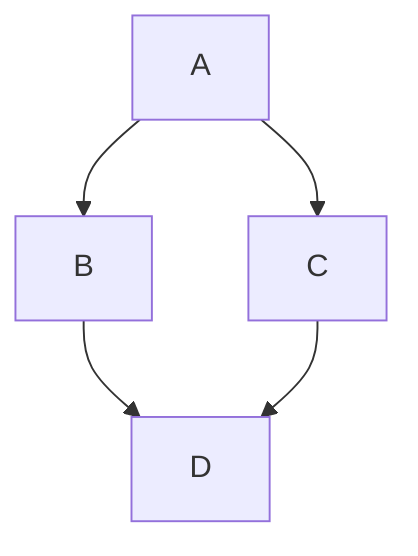

The `mermaid` feature marks [Mermaid](https://mermaid.js.org/) fenced code
blocks at build time. zfb replaces the code block with a `<div
class="mermaid">`; diagram rendering happens client-side when your Mermaid
runtime processes that element.

## Enable

```ts
// zfb.config.ts
import { defineConfig } from "zfb/config";

export default defineConfig({
  markdown: {
    features: {
      mermaid: true,
    },
  },
});
```

## Usage

Write a fenced code block with the `mermaid` language tag:

````md

````

At build time, the plugin replaces the `<pre><code class="language-mermaid">`
block with:

```html
<div class="mermaid" data-mermaid="">graph TD; ...</div>
```

The `data-mermaid` attribute and `mermaid` class signal a client-side Mermaid
renderer to process the block. The source is preserved as a HAST text node. HTML serialization escapes `&`, `<`, and `>` as `&amp;`, `&lt;`, and `&gt;`. Parsing that HTML restores the original DOM text, so the Mermaid renderer receives the unmodified DSL; this is not raw, unescaped HTML insertion.

## Visitor ordering

`MermaidPlugin` runs **before** `SyntectPlugin` in the hast phase. This ensures syntect does not attempt to syntax-highlight mermaid blocks; once the `<pre>` is replaced by a `<div class="mermaid">`, syntect's `<pre><code>` selector no longer matches it.
